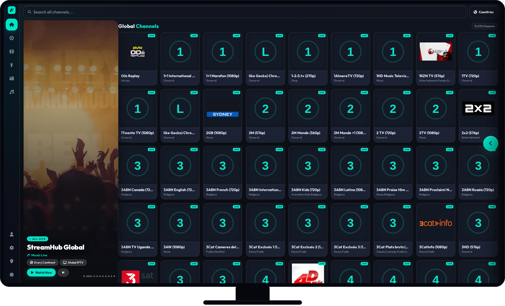
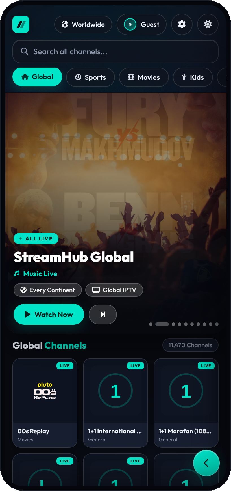
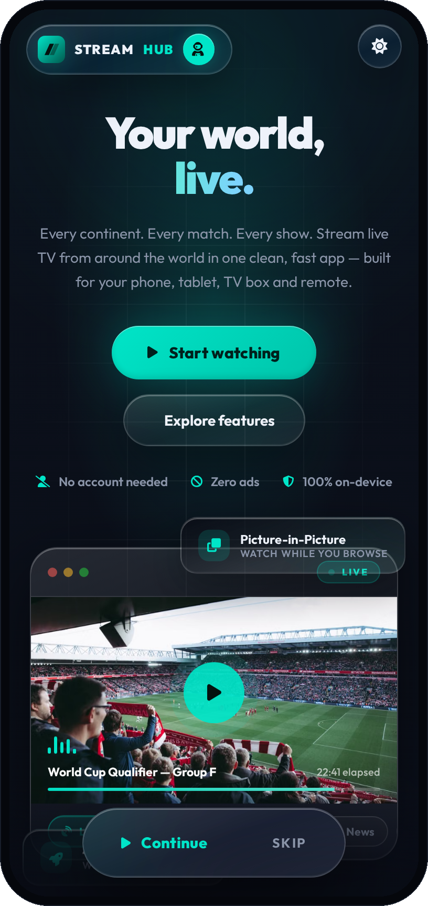

<p align="center">
  
</p>

<h1 align="center">StreamHub</h1>

<p align="center">
  <b>Cross-platform live TV</b> — one codebase, three native apps<br>
  Android phone · tablet · TV &nbsp;|&nbsp; iPhone · iPad &nbsp;|&nbsp; Windows PC
</p>

<p align="center">
  
  
  
  
</p>

---

## Layouts

**TV — 10-foot interface, fullscreen rail layout with D-pad navigation**

<p align="center">
  
</p>

**Phone & iPhone — the same app, responsive down to the smallest screen**

<table align="center">
  <tr>
    <td align="center" width="50%">
      <br>
      <sub><b>Android phone</b> — home, search & live grid</sub>
    </td>
    <td align="center" width="50%">
      <br>
      <sub><b>iPhone</b> — welcome screen</sub>
    </td>
  </tr>
</table>

---

## What you get

- **Live stream playback** — HLS via hls.js with quality selection (Auto /
  1080p / 720p / 480p), buffering profiles, fit modes, floating mini player
  with in-bubble channel switching, and a slide-out TV guide.
- **11,470+ channels** — DStv, GOtv and global live streams grouped into
  Global, Sports, Movies, News, Kids and Music, with genre chips, search,
  continent → country filtering and per-country channel counts.
- **Every screen preserved** — the original splash animation, landing page
  (onboarding, profile capsule, liquid-glass dock) and streamer app ship
  exactly as designed in `web/`, identical on every platform.
- **Built for the big screen** — leanback launcher entry, TV banner, no
  touchscreen requirement, remote/D-pad spatial navigation and a dedicated
  10-foot UI mode with larger targets.
- **Zero account, zero ads** — everything runs on-device; playlists and
  streams are fetched directly, nothing is proxied or tracked.

## Download & install

Every release is built by GitHub Actions from the source at that tag —
real native builds, no simulators, no mocks. Grab the files on the
**[Releases page](https://github.com/xspeen/StreamHub/releases)**:

| Platform | File | How to install |
|---|---|---|
| Android phone / tablet / TV | `StreamHub-<version>.apk` | Open the APK → allow unknown sources. Updates install over the previous version (same key). TV: `adb install` or copy to the device. |
| iPhone / iPad | `StreamHub-<version>-ios.ipa` | Sideload with SideStore / AltStore (recommended), Sideloadly, TrollStore, or Xcode → Devices. iOS 15+. |
| Windows PC (x64) | `StreamHub-<version>-windows-x64-setup.exe` | Run the installer (WebView2 installs automatically). If SmartScreen appears: More info → Run anyway. |

Verify any download with `SHA256SUMS.txt` from the same release.
Full per-device steps and troubleshooting: **[INSTALL.md](INSTALL.md)**.

## Cutting a release

One tag builds and publishes everything:

```bash
git tag v1.0.5
git push origin v1.0.5
```

The **Release** workflow resolves the version, then builds the signed
Android APK, archives a real-device iOS app and produces the Windows NSIS
installer in parallel — verifying the APK signature (v1+v2, release
fingerprint) and the bundled web assets — and finally publishes a single
GitHub Release with all binaries, the source zip and `SHA256SUMS.txt`.
Manual runs are available via `workflow_dispatch`.

## Building from source

```bash
# Android (JDK 17 + Android SDK)
./gradlew :app:assembleRelease

# iOS (Xcode + XcodeGen) — real device build
xcodegen --spec ios/project.yml
xcodebuild -project ios/StreamHub.xcodeproj -scheme StreamHub \
  -destination 'generic/platform=iOS' archive

# Windows (Rust + Node)
cd windows && npm install && npx tauri build
```

CI runs the Android debug build on every push to `main`
(`.github/workflows/android-ci.yml`).

```
web/          The app itself — splash.html, landing.html, app.html
app/          Android project (Kotlin WebView shell around web/)
ios/          iOS project (XcodeGen spec + SwiftUI WKWebView shell)
windows/      Tauri v2 project (WebView2 + NSIS installer)
media/        Logo and layout screenshots used by this readme
signing/      Release keystore (see Signing)
.github/workflows/  android-ci.yml, release.yml
```

## Signing

Every release APK is signed with `signing/streamhub.keystore` (alias
`streamhub`), committed **on purpose** so CI-built and locally built
releases stay on the same key — updates never fail with a signature
mismatch. Certificate SHA-256:

```
1a264afc0cd58656eae8268b837cfa6847fcfae4787104312fe683c45a39bf3f
```

The release workflow re-checks this fingerprint on every build.

## License

MIT — see [LICENSE](LICENSE).
